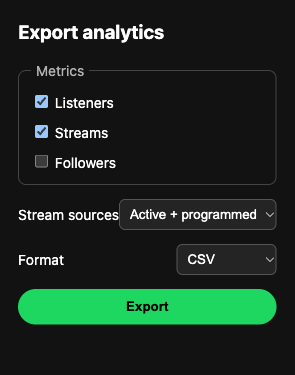
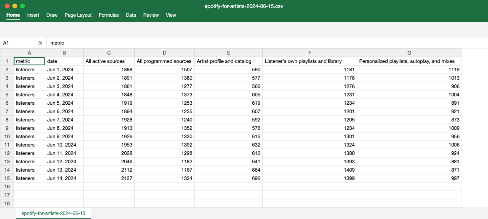

# Spotify for Artists Data Exporter

Spotify for Artists 분석 화면에 보이는 차트 데이터를 **JSON · CSV · XLSX** 파일로 내보내는 크롬 확장 프로그램입니다.

A Chrome extension that exports the charts visible in Spotify for Artists analytics as JSON, CSV, or XLSX. (English summary below.)

---

## 문제 

필요한 데이터가 Spotify for Artists 대시보드 **안에서만 보이고 파일로는 받을 수 없는** 경우가 있습니다.


<sub>Spotify for Artists의 유입 경로별(Source of streams) 화면 예시. 화면에서 볼 수만 있고 내려받을 수는 없다. 이미지 출처: [r/SunoAI, “My AI artist has over 50k monthly listeners”](https://www.reddit.com/r/SunoAI/comments/1tb21ul/my_ai_artist_has_over_50k_monthly_listeners/) (이 프로젝트와 무관한 공개 게시물)</sub>

화면을 보며 숫자를 손으로 옮기면 시간이 오래 걸리고 실수가 생깁니다. 그래서 화면에 그려진 차트에서 값을 읽어 표로 저장하는 도구를 만들었습니다.

## 사용법

1. Spotify for Artists 분석 페이지에서 원하는 차트를 화면에 띄웁니다.
2. 확장 프로그램을 열고 지표, 스트림 경로 필터, 파일 형식을 고릅니다.
3. **Export**를 누르면 날짜별 데이터가 파일로 저장됩니다.



| 선택 항목 | 옵션 |
| --- | --- |
| 지표 | Listeners, Streams, Followers |
| 스트림 경로 | 화면에 표시된 전체 / Active + Programmed만 |
| 파일 형식 | JSON, CSV, XLSX |

스트림 경로가 나뉜 차트를 내보내면 경로마다 열이 하나씩 생깁니다. 아래는 내보낸 CSV를 엑셀로 연 모습입니다. (값은 형식을 보여주기 위한 예시입니다.)



## 작동 방식

- 차트의 각 막대에 붙어 있는 접근성 라벨(`aria-label`)을 읽어 날짜와 경로별 값으로 나눕니다.
- **Spotify의 비공개 API를 호출하지 않습니다.** 로그인한 사용자가 이미 화면에서 볼 수 있는 값만 읽습니다.
- 추출 로직(`extractors/`), 파일 변환(`export/`), 화면(`popup/`)을 분리해 지표나 형식을 추가하기 쉽게 만들었습니다.

```text
manifest.json        확장 프로그램 설정 (artists.spotify.com에서만 동작)
content.js           페이지에서 추출 요청을 받아 처리
extractors/          차트 라벨 파싱(chart.js)과 지표별 추출기
export/              JSON · CSV · XLSX 변환
popup/               지표·경로·형식 선택 화면
utils/helpers.js     숫자·날짜 정리, CSV 변환
SFA_script.js        처음 만든 브라우저 콘솔용 스크립트 (확장 프로그램의 원형)
```

## 설치 (개발자 모드)

1. 이 저장소를 내려받습니다.
2. 크롬에서 `chrome://extensions`를 엽니다.
3. 오른쪽 위 **개발자 모드**를 켭니다.
4. **압축해제된 확장 프로그램을 로드합니다**를 누르고 이 폴더를 선택합니다.
5. Spotify for Artists 분석 페이지에서 차트를 띄운 뒤 확장 프로그램 아이콘을 누릅니다.

## 주의사항

- 화면에 **현재 그려진** 차트만 읽습니다. 기간을 바꾸면 그 기간으로 다시 내보내야 합니다.
- 개인 분석 용도로 만든 도구이며, Spotify와는 관련이 없습니다.

---

## English summary

Some Spotify for Artists charts, such as daily streams split by source, can be viewed but not downloaded. This extension reads the accessible labels (`aria-label`) of the rendered chart and exports the values as JSON, CSV, or XLSX. It does not call Spotify's private APIs and only reads data already visible to the signed-in user.

**Install:** open `chrome://extensions`, enable Developer mode, click **Load unpacked**, and select this folder. Then open a Spotify for Artists analytics page, show the chart you need, and click **Export** in the extension.
